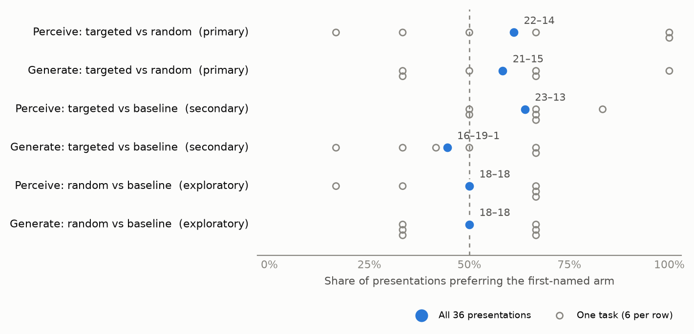
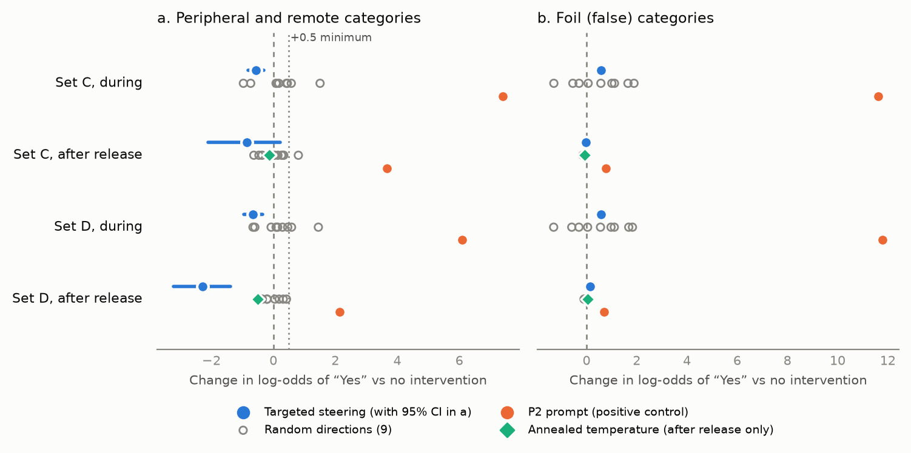

# Steering Did Not Decategorize: Pre-Specified Tests of "Decategorize, Then Develop" in an 8B Language Model

David Cook, Independent Researcher

Manuscript v0.7 · November 2, 2026

> **Publication status.** This version was submitted to TMLR on 3 November 2026 and was rejected. It is not being resubmitted. It is published here unchanged, apart from this note and the header line, as a record of a pre-specified negative result. AI tools assisted with drafting, analysis code and revision; see [NOTICE](../../NOTICE).

## Abstract

DREAM tested a theory of creative generation. An idea is introduced while a language model is pushed out of its usual categories ("decategorized"), then developed as the model returns to its ordinary state. We asked whether activation steering, which adds a fixed direction to one layer's activations, can produce that state in Qwen3-8B, and whether it improves the ideas that result.

**Studies 1 and 2 (pilots).**
- Steering the *writing* of ideas, followed by fresh-context development, did not establish an advantage. Under a strict absolute endpoint, no final idea in any condition qualified (0 of 698), leaving that endpoint uninformative for comparing arms.
- Steering the *reading* of a task, followed by same-context development, led a matched random direction 22–14 and no steering 23–13 under a model judge. That is a small, unconfirmed lead on six tasks, and a condition-masked review by the author on the same pairs did not reproduce it (targeted 7–10 against random, 6–10 against baseline).
- A manipulation check found that the "decategorization" direction changed category labels less often than a random direction did.

**Study 3 (direction validation).**
- Pre-specified screens compared three candidate directions with nine random directions at three layers.
- Reading-only steering at λ ≤ 0.8 and write-time steering at λ ≤ 0.4 were tested. No cell beat all random directions on category change and abstractness and then replicated on held-out objects.

**Study 4 (categorization check).** This was revised after an external methods review and frozen before data.
- **Membership:** steer-then-release steering with the best-performing direction produced lower peripheral and remote category endorsement than the matched-random mean. This held during the intervention and after release, on two fresh object sets (−0.55 and −0.65 log-odds during, with 95% CIs below zero). Loosening of the declared minimum size (+0.5 log-odds) is ruled out.
- **Associations:** dispersion rose by a quarter of the declared minimum.
- **Positive control:** a short prompt asking the model to set aside familiar groups produced large changes. But they were not selective. It raised acceptance of clearly false categories (+11.6 log-odds) more than remote ones (+7.4), and collapsed confidence in typical ones.

**Conclusion.** We found no evidence that this steering decategorizes, and evidence against loosening of a meaningful size. The study contributes a pre-specified negative result, a reusable protocol for checking whether an intervention changes categorization, and a record of measurement failures that would otherwise have produced false positives.

## 1. Introduction

A creative assistant should offer connections that people can understand, develop or use; unusual wording is not enough. DREAM began from a two-step theory of how such connections arise:
1. An idea is *introduced* in a loosened state, where familiar category boundaries are weakened.
2. It is *processed while returning to baseline*, so that ordinary, constraint-respecting thought works on an unusual representation.

The human analogy is the half-awake insight that is worked out later, awake.

We tried to produce the loosened state with activation steering: adding a fixed "decategorization" direction to one decoder layer's hidden states. Steering is temporary, leaves the weights unchanged, and can be faded to zero on a schedule. Activation additions are known to shift model behaviour [1,2], and creativity-specific steering has been reported [3,4]. Whether a direction labelled after a cognitive construct actually changes that construct is rarely tested directly.

This paper reports the full sequence of pre-specified tests, including the ones that failed:
- **Studies 1–2:** two efficacy pilots.
- **Study 3:** a direction-validation programme.
- **Study 4:** a categorization check whose design was tightened by an external methods review before any data were scored.

Our contributions are:
1. **A pre-specified negative result.** In Qwen3-8B, the targeted directions did not loosen categories or broaden associations beyond matched random perturbations, across reading-only, write-time and steer-then-release schedules. The best candidate's measurable effect on category membership ran the other way.
2. **A construct-validity protocol for "decategorization".** It has four parts: membership log-odds over typical, peripheral, remote and clearly false categories; robustness across several frozen question wordings; measurement both during the intervention and after release; and an association measure with a relevance safeguard. All are judged against matched random directions with object-level uncertainty.
3. **Evidence that an obvious alternative is not selective.** A prompt asking the model to set aside familiar groups produced large, replicated shifts in framing, but on these measures it flattened category judgments rather than loosening them.
4. **A measurement audit.** It covers an extraction artifact that reversed an arm comparison, judge scope and calibration errors, two failed judge qualifications, an absolute endpoint that hit a floor, and a pilot lead that the direction validation did not support.

We do not claim the theory is false. We claim that this intervention did not produce the state the theory requires.

## 2. Related work

Activation Addition and Contrastive Activation Addition steer models through additive directions in activation space [1,2]. Creativity-specific steering has been studied for generation and assessment [3], and weight steering has been compared with activation steering on divergent-thinking tasks [4]. Vechtomova et al. use activation steering as controlled disruption to produce creative estrangement in narrative [5]. That work is the closest precedent to our loosened state.

Self-Refine shows that revision alone can improve outputs [6], so steering must be compared with controls that receive the same development. Nakajima et al. assess novelty conditional on appropriateness [7]. Model-based judges show position, verbosity and self-preference biases [8,9]. Probability-based classification is sensitive to wording and label order [10], which motivates our multiple frozen formulations. GloVe [11] supplies a fixed, reproducible word space for the association measure.

We add three things:
- the reading-versus-writing distinction for steering;
- explicit comparison with matched random directions on construct measures;
- evidence that a direction's label need not match its measured effect.

## 3. General methods

**Model and intervention.**
- The generator is Qwen/Qwen3-8B (revision `b968826d9c46dd6066d109eabc6255188de91218`, reasoning off) in bfloat16 on one 24 GB GPU. Study 1 also used mistralai/Mistral-7B-Instruct-v0.3 (revision `c170c708c41dac9275d15a8fff4eca08d52bab71`).
- For token state h and unit direction v, steering sets h′ = h + λ(t)·‖h‖·v at the residual output of one decoder block.
- Random controls are nine frozen Gaussian unit directions (seeds 271828–271836), applied at the same block, strength and schedule.
- The checkpoint is read-only: nothing is trained, and hooks are removed after each call.
- All model work ran offline in a sandbox, with a welfare observer and resource limits. A full test suite ran inside the sandbox before every launch.

**Candidate directions** (Study 3 onward).
- **D0:** the original direction, the mean last-prompt-position difference between prompts asking for decategorized versus categorical thinking. At block −8 its cosine with the Study 1–2 vector is 1.00.
- **D1:** the same contrast, averaged over the model's own *generated* answer tokens.
- **D2:** a contrast between abstract/poetic and concrete/literal descriptions, also pooled over generated text.

**Records.**
- Before each study's data existed, its design, metrics, thresholds and decision rule were written down and hashed, with exact files and code hashes.
- These are local timestamped records, not public preregistrations.
- Later changes were logged in an append-only amendment record.
- Nothing was resampled, and no threshold was changed after results were seen.
- Comparisons added after results are labelled exploratory.

## 4. Studies 1 and 2: efficacy pilots

### 4.1. Study 1: steering the writing of ideas

**Design.** Each chain had three calls:
1. ideation (five ideas I1–I5);
2. unsteered development;
3. unsteered finalization in fresh contexts.

The four ideation arms were strong prompting (temperature 0.6, top-p 0.95, top-k 20), high temperature (1.3), targeted steering and random steering (both at the ordinary sampling settings). Development and finalization were unsteered at temperature 0.6. Every stage allowed 3,072 new tokens, with input allowances of 4,096, 8,192 and 12,288 tokens; no input was silently truncated, and a model-generated loop or length stop counted as an outcome, never as grounds for resampling. Steering rose to λ 0.20 over 50 tokens, held for 100 and fell over 200, at block −8. There were 6 tasks × 3 seeds × 4 arms per model (Qwen3-8B, Mistral-7B).

**Endpoint.** A final idea qualified if a judge scored novelty, value and coherence each ≥ 3/4, constraints passed, and it descended from a cited source idea. Judges had to pass a qualification fixed in advance (Section 8.2). Only Claude (claude-opus-5-5) passed, so the ratings below are an exploratory, single-judge analysis with a 10% repeat audit (same ≥ 3 decision on 98–99%).

**Result.** No final idea qualified:
- Qwen3: 0 of 359;
- Mistral: 0 of 339;
- developer cohort: 0 of 108.

Novelty was the binding facet: arm means were 1.08–1.30, and one idea in 698 scored 3. Value and coherence were similar across arms. The strict absolute endpoint left no variance to compare.

### 4.2. Study 2: steering the reading, developing in the same context

**Design.** Each chain was one continuous generation with IDEAS, THINKING, DEVELOPMENT and FINAL sections. There were five arms:
- **Baseline.**
- **Perceive-targeted and perceive-random:** the task text was steered at λ 0.20 while it was read, and decoding steering then glided to zero over 300 tokens.
- **Generate-targeted and generate-random:** steering rose, held while ideas were written, and fell, all in the same context.

The study ran 6 new tasks × 3 seeds × 5 arms = 90 chains.

**Endpoint.** A blind pairwise judge, qualified before use (16/16 directional, 6/6 ties on identical answers), saw two anonymous FINAL sections. It picked the more surprising yet workable (practical) or intelligible (artistic) connection, in both display orders.

**Result** (Table 1; Figure 1).
- **Primary contrasts:** targeted led random 22–14 (perceive) and 21–15 (generate). Tasks split 3/2/1 in both, sign test p = 1.0.
- **Secondary:** perceive-targeted led baseline 23–13 (tasks 4/0/2, p = 0.125).
- **Exploratory:** random tied baseline 18–18 in both modes.

The ordering targeted > random ≈ baseline in perceive mode was the best lead in the programme. A greedy category-listing check, however, found that targeted reading changed the subject's category labels in 3 of 18 cells, against 7 of 18 for random. That prompted Study 3.

Table 1. Study 2 blind pairwise judgements (Claude, pairwise-c1). Each row covers 6 tasks × 3 seeds × 2 display orders = 36 presentations.

| Comparison | Status | First–second–tie | Tasks first / second / even |
| --- | --- | --- | --- |
| Perceive: targeted vs random | primary | 22–14–0 | 3 / 2 / 1 |
| Generate: targeted vs random | primary | 21–15–0 | 3 / 2 / 1 |
| Perceive: targeted vs baseline | secondary | 23–13–0 | 4 / 0 / 2 |
| Generate: targeted vs baseline | secondary | 16–19–1 | 2 / 3 / 1 |
| Perceive: random vs baseline | exploratory | 18–18–0 | 3 / 2 / 1 |
| Generate: random vs baseline | exploratory | 18–18–0 | 3 / 3 / 0 |

Figure 1. Share of the 36 presentations preferring the first-named arm. Open points are the six tasks; the dashed line marks no preference.

## 5. Study 3: does any direction loosen categories more than random?

**Probes.** Each screen used 24 held-out objects and two greedy probes per object:
- "List five categories that this object belongs to" (category Jaccard distance from baseline);
- "Describe this object in two sentences" (mean Brysbaert concreteness [12], scored as an abstractness shift).

**Pass rule.** A cell (direction × block × strength) passed if it beat **all nine** random directions on **both** metrics, with ≥ 90% valid outputs. From the dose extension onward, a passing cell also had to pass again on a second held-out set of 24 objects.

**3a. Reading-only steering, λ 0.10 and 0.20.**
- D0, D1 and D2 were tested at blocks −12, −8 and −4. No cell passed.
- At these strengths, 65–94% of greedy outputs were unchanged for every direction, random included.
- D0, the direction used in Studies 1–2, never ranked above the median random direction.

**3b. Reading-only steering, λ 0.4–0.8** (D1, D2).
- One of 18 cells passed by a hair: D1 at block −12, λ 0.4, with category distance 0.411 vs 0.401 and abstractness 0.059 vs 0.058.
- It failed replication on abstractness (0.032 vs 0.047).
- At λ 0.8, outputs changed as often under random directions as under the candidates. The changes were rewordings and near-synonym swaps.

**3c. Write-time steering, λ 0.1–0.4** (constant during decoding; D0–D2).
- Two of 27 cells passed on the first set: D0 at −4/0.4 and D2 at −4/0.2. Both failed replication.
- *Exploratory:* candidates exceeded the best random direction on category distance in 25 of 27 cells, but rarely on abstractness. These cells share objects and settings, so they are not 27 independent replications.

**3d. Prompt wording (no steering).**
- Three decategorization wordings without style words were compared with nine neutral wordings of similar length.
- One wording, P2 ("Approach this object without sorting it into its familiar groups. Let its features connect freely to things from very different domains before you answer."), passed and replicated:
  - category distance 0.962 vs 0.582 for the best neutral wording;
  - abstractness 0.199 vs 0.055.
- Its outputs were metaphorical. A sundial became "a silent conversation between light and stone".
- We stated in advance that its category change partly reflects instruction-following.

**Interpretation.** None of the steering methods replicated. The pilot's best condition, D0 under reading-only steering, was never better than a typical random direction. The prompt changed framing reliably, but whether that is decategorization was left to Study 4.

## 6. Study 4: a categorization check, during and after release

### 6.1. Hypothesis and design history

The author restated the hypothesis as follows: *temporarily loosening learned representational constraints changes how the model interprets a problem, allowing connections that improve the final answer after ordinary processing resumes.* We first had to establish that categorization changes at all (Stage A). Masked human review of originality and usefulness (Stage B) would follow only if Stage A passed.

**Design history.**
- A first version of Stage A was frozen and launched.
- An external methods review was then submitted, asking for six changes:
  1. clearly inapplicable categories and a stated basis for membership;
  2. fixed-temperature log-odds with several frozen question wordings;
  3. temperature used only as an association comparator, frozen on separate calibration objects;
  4. a relevance safeguard for embedding dispersion;
  5. separate measurement during the intervention and after release;
  6. quantitative thresholds with object-level uncertainty.
- The first run was stopped at 161 of its test records. None was opened and the scorer was never run. It was withdrawn and kept on file.
- Version 2 adopted all six changes and was frozen, with hashes of the items, probe code and scorer, before any test data existed.

### 6.2. Items and arms

**Items.** Two fresh object sets (C, the screen; D, the replication) of 24 objects each, disjoint from every earlier set and from sealed confirmation tasks. Each object has eight authored categories:
- two typical;
- two peripheral;
- two remote, defensible only through a stated basis: form, function or common use (e.g. "scissors → levers (form)");
- two foils, clearly inapplicable.

**Arms.**
- **Baseline.**
- **Targeted:** D1 at block −12, λ 0.20. It was chosen by a stated rule from already-seen data (the largest category margin in Study 3c). The schedule was steer-then-release: full dose at the prompt's last position and first answer token, then a raised-cosine glide to zero over 64 tokens.
- **Nine random directions:** same block, strength and schedule.
- **P2 prompt,** as a positive control.
- **Annealed temperature:** from peak T to 0.001 over the same 64-token curve, with five seeds, for association-based measures only. T was chosen on separate calibration objects to match the targeted arm's semantic shift.

### 6.3. Measures

**M1, membership during the intervention.** "Is this object a member of the category 'X'? Answer Yes or No."
- **Wordings:** two more frozen wordings, one with the label order reversed.
- **Score:** log Σ P(Yes-variants) − log Σ P(No-variants) at the first answer token, from one forward pass at temperature 1.
- **Primary measure:** change versus baseline on peripheral and remote categories, averaged over wordings.

**M2, membership after release.** The arm's own association answer stays in the conversation, the steering hook is removed, and the whole context is re-read unsteered. The membership question is then asked as a new turn. The only thing carried over is what the arm wrote. Zero steering does not show that ordinary processing has recovered.

**M3, association dispersion.** "List ten single words you associate with this object."
- **Score:** mean pairwise GloVe cosine distance among the deduplicated associates, needing ≥ 6 in vocabulary.
- **Relevance:** mean similarity of the associates to the object's name and description.
- **Qualification:** on calibration objects, deliberately unrelated lists had to score higher dispersion *and* lower relevance than baseline lists. They did: 0.974 vs 0.807, and 0.064 vs 0.390.

**Pass rule, per measure and set.** Objects are the analysis units (n = 24). The targeted arm had to:
- (a) beat all nine random directions;
- (b) have a paired bootstrap 95% CI for (target − random mean) above zero;
- (c) reach a minimal meaningful change: +0.5 log-odds for M1 and M2, and a frozen dispersion threshold of 0.033 for M3;
- (d) stay healthy:
  - typical change ≥ −0.5;
  - foil change ≤ +0.25;
  - label mass ≥ 0.5;
  - a positive direction in each wording;
  - for M3, a relevance drop ≤ 0.081.

**Gates and checks.**
- Gate 1 (immediate change) required M1 and M3. Gate 2 (survives release) required M2. Stage B required both gates on both sets.
- **Instrument check:** baseline log-odds must order typical > peripheral > remote > foil.
- **Positive control:** P2 must detect against the random directions.
- If either check failed, the result would be inconclusive rather than null.

### 6.4. Results

**The checks held.**
- Baseline log-odds on set C were +16.6 (typical) > +2.0 (peripheral) > −20.2 (remote) > −32.8 (foil), with the same order on set D.
- P2 met its detection criteria.
- Calibration chose T = 1.5, the top of the grid. Even that temperature shifted associations less than steering did (0.078 vs 0.117), so the temperature comparison is under-matched.

**M1.** Targeted steering *reduced* acceptance of peripheral and remote categories (Table 2; Figure 2).
- Change vs baseline: −0.55 [−0.81, −0.31] on C and −0.65 [−0.96, −0.35] on D.
- Below the random mean by −0.74 [−1.00, −0.48] and −0.84 [−1.15, −0.53]. Some individual random directions scored lower than targeted steering.
- It also reduced typical acceptance (about −3.0) and raised foil acceptance slightly (+0.57).
- The shift was negative in all three wordings.

**M2.** After release, the shift persisted in the same direction: −0.86 [−2.10, +0.22] on C and −2.28 [−3.22, −1.38] on D. The temperature arm was near zero (−0.13, −0.51).

**M3.** The targeted arm's dispersion gain was +0.009 (C) and +0.005 (D).
- That nominally exceeds all nine random directions on both sets, but is about a quarter of the declared minimum.
- The target-versus-baseline CI upper bounds were +0.0193 (C) and +0.0184 (D), below the declared baseline-gain minimum of +0.0334. The separate target-minus-random-mean upper bounds were about +0.0219 on both sets.
- It was not distinguishable from temperature, which was itself under-matched.

**Decision (as declared).** No demonstrated change in categorization, and the steering branch is closed. On both sets, the CI upper bounds exclude loosening of ≥ 0.5 log-odds (during and after release) and dispersion gains of ≥ 0.033.

Table 2. Study 4 results on fresh object sets (24 objects per set; 95% paired bootstrap CIs). Membership measures use n = 24 on each set. The common-valid association gate uses n = 24 on C and n = 23 on D; the D targeted-versus-baseline dispersion mean is therefore the mean on that common 23-object subset.

| Measure | Set | Targeted vs baseline | Best random | Targeted − random mean | Declared minimum |
| --- | --- | --- | --- | --- | --- |
| M1 membership, during (log-odds) | C | −0.55 [−0.81, −0.31] | +1.51 | −0.74 [−1.00, −0.48] | +0.50 |
| | D | −0.65 [−0.96, −0.35] | +1.45 | −0.84 [−1.15, −0.53] | +0.50 |
| M2 membership, after release | C | −0.86 [−2.10, +0.22] | +0.81 | −0.91 [−2.05, +0.15] | +0.50 |
| | D | −2.28 [−3.22, −1.38] | +0.42 | −2.20 [−3.10, −1.38] | +0.50 |
| M3 association dispersion | C | +0.009 | +0.007 | +0.011 [+0.000, +0.022] | +0.033 |
| | D | +0.005 | +0.001 | +0.009 [−0.004, +0.022] | +0.033 |

Figure 2. Change in log-odds of "Yes" versus no intervention, during the intervention and after release, on both fresh sets. (a) Peripheral and remote categories; the dotted line marks the declared +0.5 minimum. (b) Clearly false (foil) categories. Targeted steering (blue, with 95% CI) sits below the random-direction mean in (a); some individual random directions (open circles) fall below it. The P2 prompt (orange) raises acceptance of false categories even more than of remote ones.

### 6.5. The positive control was not selective

P2's changes were large, but in the wrong pattern for decategorization:
- **During:**
  - peripheral and remote +7.4 (C) and +6.1 (D);
  - foils **+11.6** and **+11.8**;
  - typical −12.6 and −13.4.
- **After release:** peripheral and remote +3.7 and +2.1; foils +0.8 and +0.7; typical −4.4 and −5.0.
- **Associations:** dispersion gained about +0.05, but with a relevance drop of 0.16–0.18, about twice the safeguard limit. The common-valid positive-control dispersion gate used n = 24 on C and n = 22 on D. A lunchbox became "portability, nostalgia, compartmentalization, sustenance…".

P2 therefore pulls category judgments toward indifference rather than loosening them selectively. Under the standard the review proposed (more acceptance of defensible remote categories *without* more acceptance of false ones), it is not decategorization either. It shows that the measures detect explicitly instructed cross-domain responding, and nothing about subtler effects.

## 7. Discussion

### 7.1. What the evidence says

The theory needs an intervention that loosens categories. Across four pre-specified tests, the targeted directions never did so beyond matched random perturbation:
- reading-only steering at λ ≤ 0.8;
- write-time steering at λ ≤ 0.4;
- steer-then-release steering with the best candidate, during and after release.

In the most careful test, the best candidate lowered endorsement of peripheral and remote categories relative to the random-direction mean, while also lowering typical-category endorsement, a nonselective response shift rather than loosening; loosening of the declared size is excluded. The small Study 2 lead for steered reading (23–13 under a model judge) therefore lacks a mechanism, because the direction it used was never better than a typical random direction at changing categorization, and the author's condition-masked review of the same pairs did not reproduce it (Section 8.4). We treat that lead as unexplained, not as evidence for the theory.

### 7.2. What the evidence does not say

These results do not show that decategorization cannot be induced in language models. They cover:
- one 8B model;
- three directions built from instruction and description contrasts;
- three blocks;
- the strengths and schedules listed.

Directions found by other means (sparse features, supervised probes, or optimization against the membership measure itself) are untested, as are larger models. The result also does not test the human theory that motivated the work.

### 7.3. Why the prompt result matters

A simple prompt produced the most dramatic changes in the programme: metaphorical descriptions, cross-domain categories and broad associations. It would be easy to call that decategorization. The foil categories show it is not selective: on average the model became more willing to accept clearly false categories (foils), and by more than it accepted defensible remote ones. Any creativity study that uses "think outside categories" prompts, or steering, as a manipulation should include clearly false categories and a relevance check. Otherwise indiscriminate acceptance or irrelevant output reads as loosening.

### 7.4. Measurement lessons

1. **Extraction can manufacture effects.** In Study 1, a parser error created an 11-point apparent advantage for targeted steering (Section 8.1).
2. **Repeatability is not validity.** Judges consistently applied whole-set requirements to single ideas, or treated familiarity as low value (Section 8.2).
3. **Strict absolute gates can floor.** A conjunction of three facets at ≥ 3 left nothing to compare at this scale.
4. **Validate the manipulation before measuring efficacy.** The direction's label described how it was built, not what it did.
5. **Matched random directions are essential.** Higher doses changed outputs, but random directions changed them as much.
6. **Construct measures need negative anchors.** Foils and unrelated word lists separated selective change from indiscriminate change.
7. **Stopping a run and revising before scoring is legitimate when recorded.** Changing criteria after seeing results is not.

## 8. Measurement audit

### 8.1. An extraction error reversed an arm comparison

The Study 1 extractor fused ten Mistral final answers whose numbering it did not recognize. It also counted model-labelled "New Idea" items as sourced finals. Before repair, Mistral's targeted arm delivered 85 of 90 source-linked finals against 74–82 for the other arms. After a format-only offline repair, with every change attributed to a rule and original rows kept, the counts were targeted 85, random 85, strong prompting 84 and temperature 85 (originally 85, 74, 78 and 82). A structure check independent of the extractor now halts any run on such failures.

### 8.2. Judge qualification failed twice before one family passed

Under the first instrument (v4):
- Claude lowered *value* for familiar but workable anchors;
- Codex gave different scores to identical text.

One rule ("familiarity affects novelty only"), a lenient tie-break, and agreement defined within one scale step produced v5. Claude then passed every gate. Codex failed one scope check (11/12), on an authored item whose plot did, as Codex said, rely on an unstated rule. A pre-declared stop rule ended the two-family instrument rather than replacing the item.

### 8.3. Earlier outputs favoured the controls

In a reassessment of an earlier 12-object pilot at λ 0.40, two judge families compared steered answers with baseline and temperature-annealed answers, in both display orders (Table 3). Both families preferred the controls, most clearly on material worth developing.

Table 3. Historical pairwise preferences. Each row is 48 judgments: 12 objects × 2 display orders × 2 judge families. These are repeated judgments of 12 objects, not 48 independent trials.

| Comparison | Criterion | Steering preferred | Tie | Control preferred |
| --- | --- | --- | --- | --- |
| Steering vs baseline | Distinct non-obvious connections | 13 | 11 | 24 |
| Steering vs baseline | Concrete material worth developing | 5 | 4 | 39 |
| Steering vs temperature | Distinct non-obvious connections | 10 | 9 | 29 |
| Steering vs temperature | Concrete material worth developing | 9 | 3 | 36 |

Answer-order agreement was 16/24 (Claude) and 20/24 (Codex) for development, and 13/24 and 22/24 for connections. The two families agreed on 41/48 development comparisons but only 28/48 connection comparisons, so the development result is the firmer of the two.

### 8.4. Exploratory author review of Study 2 outputs

The author subsequently completed a condition-masked comparison of 36 Study 2 pairs: six tasks × three seeds for targeted reading against matched random reading, and the same task/seed blocks against baseline. All 36 choices were complete, and all 72 displayed answer texts matched the frozen packet. Conditions were joined after completeness and packet-identity checks. The author had previously seen aggregate study findings and AI-review summaries; all recognition responses for particular answers were "No". This is exploratory author feedback, not an independent human panel, a confirmatory efficacy test, or a blinded assessment without prior exposure.

Targeted reading received 7 preferences against 10 for matched random reading, with 1 tie; against baseline, it received 6 preferences against 10, with 2 ties. Task splits (targeted/control/even) were 2/3/1 and 3/3/0, respectively. Practical tasks contributed 4/4/1 in each comparison; artistic tasks contributed 3/6/0 against random and 2/6/1 against baseline. These descriptive results do not reproduce the model judge's small preference for targeted reading and do not establish benefit, harm, or equivalence. The same targeted answers recur across comparisons, so the 36 pairs are not 36 independent treatment observations. The task-type breakdown is post hoc and remains separate. The capture and analysis are described in Supplementary Note S1.

## 9. Limitations

- **Scale and scope:** one model for Studies 2–4, three directions, three blocks and limited strengths.
- **Items:** the Study 4 categories were authored by one person. Remote categories are defensible by a stated basis but not normed by human raters.
- **Readout:** membership is read from the first answer token. This measures categorization responses rather than directly measuring the geometry or boundaries of internal representations. Log-odds magnitudes are large at baseline, so the model is very confident about typical and false categories.
- **Temperature:** the comparator was under-matched (chosen at the grid edge).
- **Study 1:** the absolute ratings are single-judge and exploratory. The Study 2 pairwise endpoint used one judge family and six tasks.
- **Exploratory evidence:** the Study 3c 25/27 pattern is exploratory.
- **Records:** locally hashed design records are not public preregistrations.
- **Human evaluation:** no independent human panel was completed. A condition-masked author review of 36 Study 2 pairs is reported separately as exploratory feedback (Section 8.4); the author had prior exposure to aggregate findings and AI-review summaries.

## 10. Conclusion

We set out to test whether steering a language model into a decategorized state, then letting it develop ideas as the state fades, produces better ideas. Before asking whether the ideas improve, we asked whether the intervention produced a pre-specified selective change in categorization responses. With fresh objects, matched random directions, false-category anchors and measurement both during and after release, that pattern was not established. The best direction reduced endorsement of peripheral and remote categories, but also reduced typical-category endorsement and slightly increased false-category endorsement, consistent with a nonselective confidence or response shift. The prompt likewise changed responses without the required selectivity.

The theory remains untested at the level it was stated, because no intervention here produced its required state. What this work offers is a negative result with stated bounds, and a protocol that future attempts can use to check that their manipulation does what its name claims.

## Data, code and availability

The following are preserved with hashes:
- run records and source versions (1.4.2, 1.5.0–1.5.5);
- design records and amendment log;
- judge prompts and qualification fixtures;
- raw judgements and model outputs (including the withdrawn Stage A v1 records, never scored);
- calibration files and analysis scripts.

Condition keys for masked reviewer packets are held privately until reviews are submitted. Permanent archive identifiers are pending.

## AI assistance and authorship

Claude Code implemented experiments, coordinated execution, ran isolated judge calls and drafted text. Codex assisted with earlier recomputation and drafting, and an external AI-assisted methods review shaped the Study 4 design. All automated semantic ratings are model judgements. The separate exploratory author comparison is human feedback from one study author, not an independent human-panel result. The author is responsible for the final analysis and submission.

## References

[1] Turner et al. 2023/2024. Steering Language Models With Activation Engineering. arXiv:2308.10248.

[2] Rimsky et al. 2024. Steering Llama 2 via Contrastive Activation Addition. ACL.

[3] Olson et al. 2024. Steering Large Language Models to Evaluate and Amplify Creativity. arXiv:2412.06060.

[4] Schapiro et al. 2026. CreativityNeuro. arXiv:2607.01433.

[5] Vechtomova et al. 2026. Activation Steering for Creative Estrangement. ICCC.

[6] Madaan et al. 2023. Self-Refine. arXiv:2303.17651.

[7] Nakajima et al. 2026. Beyond Divergent Creativity. Findings of EACL.

[8] Zheng et al. 2023. Judging LLM-as-a-Judge with MT-Bench and Chatbot Arena. arXiv:2306.05685.

[9] Wang et al. 2024. Large Language Models are not Fair Evaluators. ACL.

[10] Zhao et al. 2021. Calibrate Before Use: Improving Few-Shot Performance of Language Models. ICML. arXiv:2102.09690.

[11] Pennington, Socher & Manning. 2014. GloVe: Global Vectors for Word Representation. EMNLP.

[12] Brysbaert, Warriner & Kuperman. 2014. Concreteness ratings for 40 thousand generally known English word lemmas. Behavior Research Methods 46:904–911.

[13] Cook. 2026. DREAM source, run records and evaluation amendments (sources 1.2.3, 1.4.x, 1.5.0–1.5.5; scoped-v4, scoped-v5, pairwise-c1). Archive identifier pending.

## Appendix A. Evidence identities

| Item | Location (under `Runs/idea-survival-20261031/`) |
| --- | --- |
| Study 1 runs | `gpu/qwen3-main-20261031-214136`, `gpu/mistral-main-20261101-014411` |
| Extraction repair | `output/extraction-v2/` |
| Judge qualification and Claude-only ratings | `judging/scope-v4/`, `judging/scope-v5/`, `judging/scope-v5-claude-only/` |
| Study 2 | `gpu/qwen3-continuity-pilot-20261102-064109`; `output/continuity/PREREG.md` (sha256 f413846c…); `judging/pairwise-c1/` |
| Study 3a | `gpu/qwen3-direction-screen-20261102-103314`; `output/continuity/DIRECTION-SCREEN-{CRITERIA,RESULT}.md` |
| Study 3b | `gpu/qwen3-dose-extension-20261102-115545`; `output/continuity/DIRECTION-SCREEN-DOSE-EXTENSION-{CRITERIA,RESULT}.md` |
| Study 3c–d | `gpu/qwen3-write-prompt-screen-20261102-131352`; `output/continuity/WRITE-AND-PROMPT-SCREEN-{CRITERIA,RESULT}.md` (criteria sha256 7217678b…) |
| Study 4 v1 (withdrawn, unscored) | `gpu/qwen3-categorization-check-20261102-151019` (`output/WITHDRAWN.md`) |
| Study 4 v2 | `gpu/qwen3-categorization-check-v2-20261102-152031`; criteria `output/continuity/CATEGORIZATION-CHECK-CRITERIA-v2.md` (sha256 63f77ff6…); calibration sha256 f07a390a…; result `output/continuity/CATEGORIZATION-CHECK-v2-RESULT.md` |
| Amendment log | `output/AMENDMENTS.md` |
